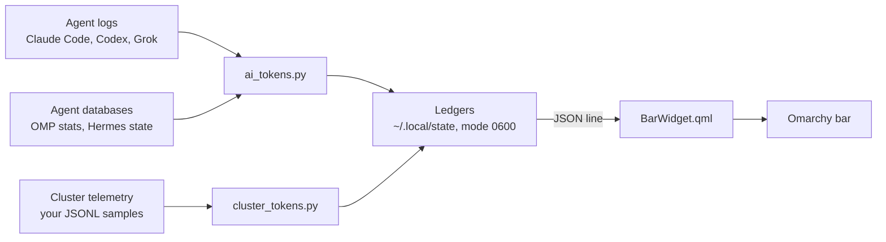

# omarchy-ai-token-bar

Two Omarchy bar widgets that count AI tokens. One reads the logs of Claude Code, Codex CLI, Grok CLI, OMP and Hermes on your machine. The other reads the output of a local model cluster that you run.

## How it works



Each widget runs a Python script once a minute and draws the one JSON line it prints. Click a widget to cycle through today, 7 days, 30 days and all time. Hover for the split by source. Right-click refreshes.

| Widget | Plugin id | Shows |
| --- | --- | --- |
| AI Tokens | `meshvault.ai-tokens` | Three chips: `CLD`, `CDX`, `GRK` |
| Cluster Tokens | `meshvault.cluster-tokens` | One chip: `OSS`, plus a dot for engine up or down |

AI Tokens counts `input + output + cache writes`. Cache reads show in the hover text but stay out of the total, because they would dominate it. The scripts open no network connection and need no API key. Ledgers keep counts, timestamps, model names and session ids. Prompt and reply text is never stored.

## Stack

Python 3 standard library for the scripts. QML for the widgets, using the `WidgetButton` API of the Omarchy 4.0.4 shell. Linux only.

## Build and run

```bash
git clone https://github.com/thefiredev-cloud/omarchy-ai-token-bar.git
cd omarchy-ai-token-bar
python3 -m unittest discover -s tests -v    # 33 tests, standard library only
./install.sh                                 # needs a running Omarchy shell
```

Check a script by hand without touching the bar:

```bash
python3 plugins/meshvault.ai-tokens/ai_tokens.py --pretty --state-dir "$(mktemp -d)"
```

[BUILD.md](BUILD.md) covers what `install.sh` changes, data sources, every setting and removal.

## Limits

- It counts only the machine it runs on and does not price tokens.
- Claude Code, Codex CLI and Grok CLI numbers cover only the log files still on disk.
- OMP numbers can lag by up to 5 minutes. Hermes keeps no per-call log, so a long session can make the day it was first seen look larger.
- Cluster Tokens shows zero until you supply a telemetry job that writes the fields in BUILD.md.
- The QML widgets and `install.sh` have no automated tests.

## License

Copyright 2026 Tanner Osterkamp. All rights reserved. See [LICENSE](LICENSE). The source is public to read; ask before reuse.
